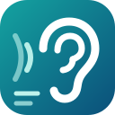

<p align="center"></p>

# OtoDita — ditado clínico para Otorrinolaringologia

O **OtoDita** (*Oto* + *ditar*) é uma aplicação web local para a consulta de ORL. Passa o ditado do médico, ou a gravação da consulta, para um registo estruturado pronto a **copiar para o SClinico**.

- **Ditado:** dita em tempo real. O texto é organizado automaticamente nas secções do registo ORL (motivo, HDA, antecedentes, otoscopia, rinoscopia, orofaringe, laringoscopia, pescoço, acumetria/vestibular, MCDT, diagnóstico, plano, seguimento).
- **Gravar consulta:** grava a consulta (com consentimento do doente). A transcrição é feita com **Whisper local** e a análise com **IA local** (Ollama / LM Studio), que separa queixas, achados, diagnóstico e plano.
- **Texto para o SClinico:** em formato *SOAP* (predefinido) ou *ORL detalhado*. Pode copiar tudo de uma vez ou bloco a bloco (útil para os campos S/O/A/P).

## Privacidade

- O OtoDita não tem servidor próprio e não guarda dados clínicos. O áudio fica só na memória do navegador. O rascunho opcional fica em `sessionStorage` e é apagado ao fechar o separador.
- A transcrição com Whisper e a IA (Ollama) correm **no próprio computador**.
- ⚠️ O motor de ditado «Navegador» (Web Speech API do Chrome/Edge) pode enviar o áudio para os servidores do fornecedor do navegador. Para tudo ficar 100% local, escolha em **Definições → Ditado → Whisper local**.
- Na primeira utilização é preciso internet para descarregar a biblioteca e o modelo Whisper. Depois ficam em cache.

## Como iniciar

Precisa de Python 3 (só para servir os ficheiros em `localhost`, o que o microfone exige) e de Chrome ou Edge.

- **Windows:** duplo clique em `iniciar.bat`
- **macOS/Linux:** `./iniciar.sh`

Abra depois `http://localhost:8765`.

### IA local (recomendado)

1. Instale o [Ollama](https://ollama.com) e descarregue um modelo com bom português:
   ```
   ollama pull qwen2.5:7b
   ```
2. Permita pedidos a partir da página do OtoDita:
   - Windows (PowerShell): `setx OLLAMA_ORIGINS "http://localhost:8765"` e reinicie o Ollama
   - macOS: `launchctl setenv OLLAMA_ORIGINS "http://localhost:8765"` e reinicie o Ollama
   - Linux: `OLLAMA_ORIGINS=http://localhost:8765 ollama serve`
3. Em **Definições → IA local**, clique em «Testar ligação». O indicador no canto superior direito fica verde.

Sem IA local, o organizador por regras continua a funcionar. Também funciona com qualquer servidor compatível OpenAI (LM Studio, llama.cpp, vLLM).

### Transcrição de consultas

- **Whisper no navegador** (predefinição, sem instalação). Os modelos `base`, `small` e `large-v3-turbo` usam a GPU (WebGPU) se existir; caso contrário usam a CPU.
- **Servidor Whisper local:** qualquer servidor com o endpoint `/v1/audio/transcriptions` (ex.: faster-whisper-server/speaches). É mais rápido para consultas longas.

## Comandos de voz (ditado)

| Diga | Efeito |
|---|---|
| «Otoscopia …», «Rinoscopia …», «Laringoscopia …», «Diagnóstico …», «Plano …» | muda de secção |
| «Otoscopia normal», «Rinoscopia sem alterações», «Acumetria normal» … | insere o texto-padrão do exame normal |
| «ponto», «vírgula», «dois pontos», «ponto parágrafo», «nova linha», «barra» | pontuação |
| «apagar última frase» | remove a última frase |

Sem cabeçalho, cada frase é classificada por termos ORL. Por exemplo, «septo desviado» vai para a rinoscopia e «pedir audiograma» vai para o plano. Os termos mal reconhecidos são corrigidos automaticamente (Rinne, Weber, Dix-Hallpike, CAE, VPPB, timpanograma tipo B, …).

Atalhos: **F2** inicia/para o ditado · **Ctrl+Shift+C** copia tudo para o SClinico.

## Estrutura

```
index.html            interface
css/styles.css        estilos (claro/escuro)
js/orl.js             secções, vocabulário ORL, comandos de voz, correções
js/organizer.js       organizador por regras
js/llm.js             IA local (Ollama / compatível OpenAI)
js/dictation.js       ditado (Web Speech ou Whisper)
js/audio.js           gravação e transcrição
js/whisper-worker.js  Whisper no navegador (transformers.js)
js/sclinico.js        formatação e cópia para o SClinico
assets/logo.svg       logótipo
tests/                testes (npm test)
```

## Aviso

O OtoDita é uma ferramenta de apoio à documentação e não é um dispositivo médico. O médico tem sempre de rever o texto gerado antes de o registar.
